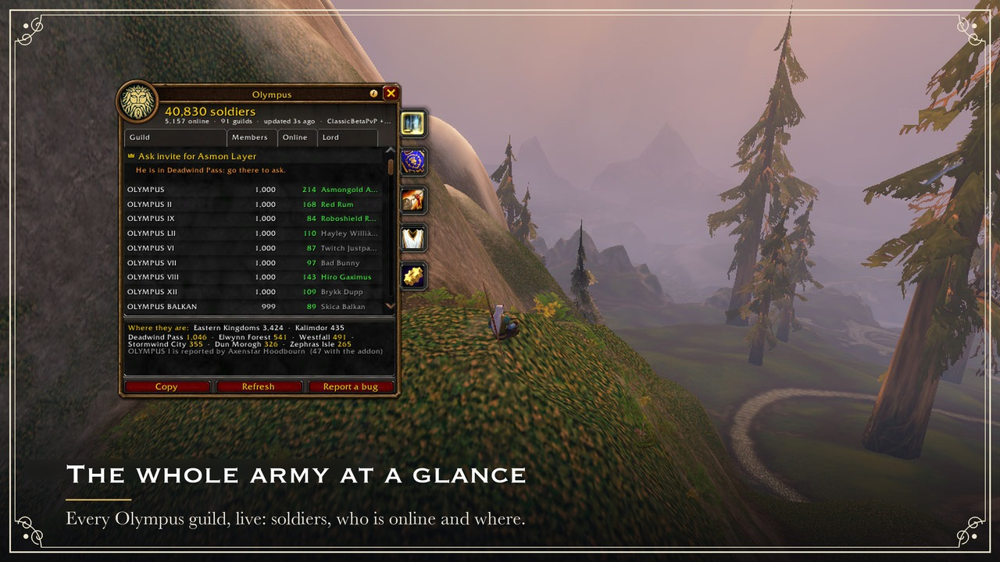
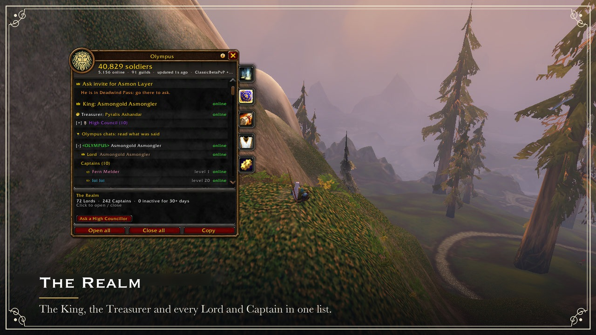
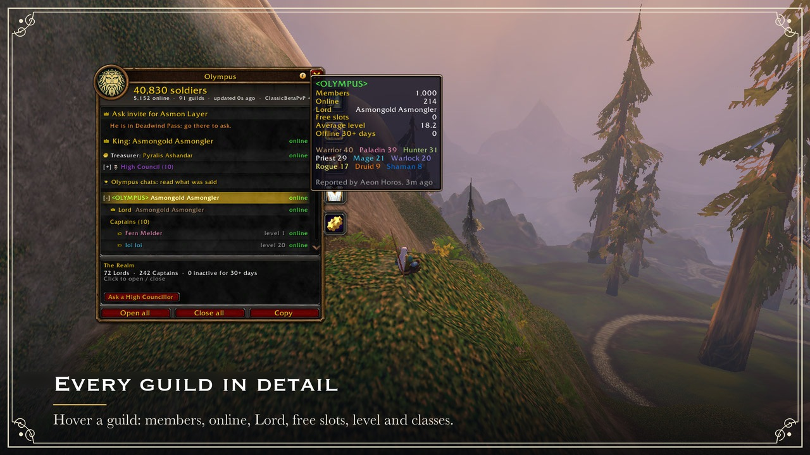
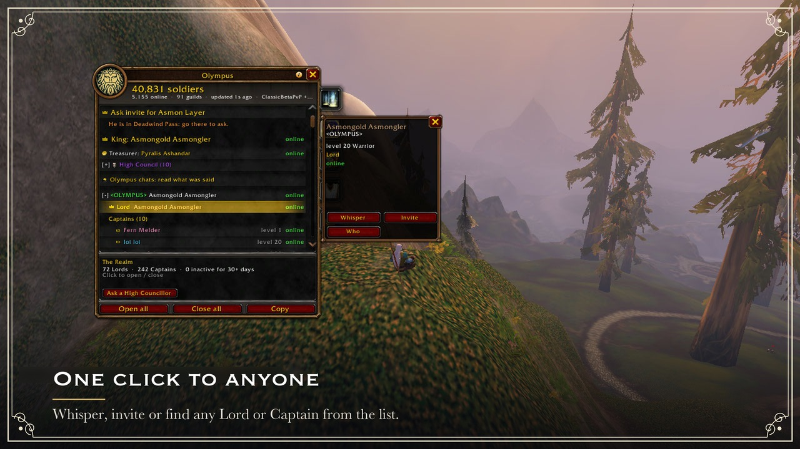
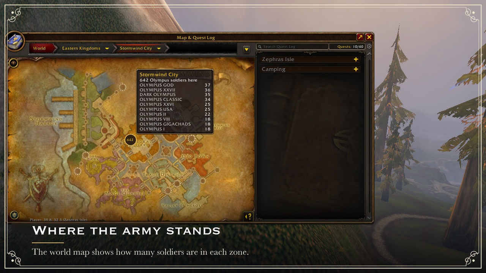

# ChillZone

Канал главы гильдии на Twitch: [twitch.tv/melharucos](https://www.twitch.tv/melharucos)

Аддон для сети гильдий «Чиллзон» и «Чиллзон Навсегда» на WoW: Forever (Альянс): общая перепись всех гильдий в одном окне рядом с окном гильдии.

В игре каждый видит состав только своей гильдии. ChillZone складывает их все вместе, в реальном времени, в окне, которое выглядит как окно гильдии Blizzard и пристыковано к нему. Аддон всегда на русском.

 Вся сеть гильдий с первого взгляда: каждая гильдия ChillZone, вживую

<table>
<tr>
<td align="center"> Игровой мир: король, казначей, все лорды и капитаны</td>
<td align="center"> Каждая гильдия подробно: наведите курсор на гильдию, и вы увидите участников, кто в сети, лорда, свободные места, уровень и классы</td>
</tr>
<tr>
<td align="center"> Один щелчок до любого: шёпот, приглашение или поиск лорда или капитана</td>
<td align="center"> Где стоит армия: свои по зонам на карте мира</td>
</tr>
</table>

Скриншоты сделаны в оригинальном аддоне Olympus: у ChillZone тот же интерфейс, другие названия и гильдии.

## Что сделано

- Это форк аддона Olympus (сеть гильдий Asmongold), переделанный под сеть гильдий ChillZone.
- У аддона своё имя, свои команды (`/cz…`), каналы и префикс сообщений: он не смешивается с Olympus и может стоять рядом с ним.
- Свои гильдии определяются по точным названиям: «Чиллзон» (её глава — король сети) и «Чиллзон Навсегда». Новые гильдии добавляются только подписанным списком владельца; «любая гильдия со словом в названии» не подходит.
- В коде зашиты ретрансляторы сети: глава гильдии и офицеры. Король, автор и казначей по-прежнему назначаются подписанным списком владельца, его собственным ключом подписи.
- Аддон всегда говорит по-русски (полный перевод), даже в английском клиенте игры. Экраны арены пока остались на английском: в оригинале русского для них нет.
- Исправлена кириллица (например, русские названия профессий на доске ремесленников).
- Свой логотип.
- Ссылки «обновить» и «сообщить об ошибке» ведут в этот репозиторий.
- Ставки золота отключены, как и в оригинале.

## Что умеет

- **Перепись и иерархия.** Сколько народу во всех гильдиях сети, кто в сети сейчас, кто глава и офицеры каждой гильдии.
- **Карта мира.** Где сейчас находятся свои, по зонам.
- **Указы.** Распоряжения главы сети и офицеров: их видят все участники.
- **Общие каналы и чат.** Один канал на всю сеть, отдельные каналы для капитанов и лордов.
- **Доска поиска групп.** Кто ищет подземелье или рейд и кто собирает группу.
- **Казна, взносы и банк.** Учёт взносов и общего банка.
- **Ремесленники.** Кто из своих что умеет делать.
- **Арена и Farkle.** Дополнительный аддон `ChillZone_Arena` с играми внутри сети.

Как всем этим пользоваться, подробно описано ниже, в разделе [Подробно о возможностях](#подробно-о-возможностях).

## Установка

1. Скачайте архив `ChillZone-x.y.z.zip` на странице [Releases](https://github.com/Bezoutoff/ChillZone-addon/releases).
2. Распакуйте его в папку `Interface\AddOns` вашего клиента Forever (обычно `World of Warcraft\_classic_era_\Interface\AddOns`).
3. Проверьте, что среди прочих там появились папки `ChillZone` и `ChillZone_Arena`. Папка `ChillZoneSiteAggregate` — маленький служебный аддон из оригинала, он безвреден, его можно оставить.
4. Перезапустите игру. При первом запуске примите ChillZone Accord (условия использования), иначе окно покажет только его.

## Основные команды

| Команда | Что делает |
|---|---|
| `/cz` | открыть или закрыть окно |
| `/cz help` | справка по командам |
| `/cz status` | состояние аддона (можно скопировать и приложить к сообщению об ошибке) |
| `/czn текст` | написать в общий канал сети |
| `/czc текст` | написать в канал капитанов |
| `/czl текст` | написать в канал лордов |
| `/cz arena` | Кровавая арена (`/cz arena help` — её команды) |
| `/cza текст` | сказать строку в комнате боя арены |

Полная таблица команд — в разделе [Все команды](#все-команды).

## Кто считается своим

Гильдии «Чиллзон» (её глава является королём сети) и «Чиллзон Навсегда». Новые гильдии добавляет автор аддона подписанным списком: просто слово в названии гильдии не делает её своей. Офицеры гильдии — второй сверху ранг. Пока не пришёл подписанный список владельца, королём считается глава «Чиллзон».

## Подробно о возможностях

Сжатое руководство, переложенное с руководства оригинального аддона: что делает каждая функция, как ей пользоваться и какая у неё команда. Того, чего в ChillZone нет (сторона Орды, Discord, сайт, ставки на золото), здесь нет. Названия вкладок и кнопок — как в игре.

**Кто есть кто.** **Армия** — все участники сети. **Король** — глава сети; пока подписанный список владельца не назовёт другого, это глава гильдии «Чиллзон». **Лорд** — глава гильдии сети, **капитаны** — её офицеры (второй сверху ранг). **Корона** — король, его Сенешаль и офицеры «Чиллзон»: они отправляют указы всей сети. **Сенешаля**, **Высший совет** и **Казначея** называет подписанный список владельца, **Десниц короля** назначает король или Сенешаль.

**Оглавление:** [Как это работает](#как-это-работает) · [Перепись](#перепись) · [Игровой мир и иерархия](#игровой-мир-и-иерархия) · [Переход в слой короля](#переход-в-слой-короля) · [Охрана группы](#охрана-группы) · [Профиль игрока](#профиль-игрока) · [Меню по правому щелчку](#меню-по-правому-щелчку) · [Указы](#указы) · [Каналы](#каналы) · [Вкладка «Чат»](#вкладка-чат) · [Доска: поиск групп и лагеря](#доска-поиск-групп-и-лагеря) · [Скрытие и отключение от сети](#скрытие-и-отключение-от-сети) · [Стража: модерация гильдии](#стража-модерация-гильдии) · [Связанные твинки](#связанные-твинки) · [Трон: король и его Десницы](#трон-король-и-его-десницы) · [Сенешаль короля](#сенешаль-короля) · [Казна: взносы и банк](#казна-взносы-и-банк) · [Накидки](#накидки) · [Заметки о добыче](#заметки-о-добыче) · [Ремесленники и заказы](#ремесленники-и-заказы) · [Миссионерская Церковь](#миссионерская-церковь) · [Разыскиваемые и Истребители](#разыскиваемые-и-истребители) · [Карта мира](#карта-мира) · [Повсюду](#повсюду) · [Приватность](#приватность) · [Безопасность и доверие](#безопасность-и-доверие) · [Все команды](#все-команды)

### Как это работает

Каждый участник видит состав своей гильдии. Аддоны гильдии выбирают одного отправителя отчётов, и он примерно раз в 3 минуты посылает в сеть короткую сводку; каждый клиент складывает сводки всех гильдий — это и есть перепись. Своего сервера у аддона нет: всё остаётся внутри игры.

**Ретрансляторы.** На мирах WoW: Forever сообщения аддонов в общих каналах не доходят до других игроков, поэтому ChillZone передаёт их шёпотом через ретрансляторов: от вас — ретранслятору, от него — отправителю отчётов каждой гильдии, от того — всей гильдии через чат гильдии. Ретрансляторы — глава гильдии и офицеры: Вован Дубан, Wipe Copium, Татарин Уфимский, Peepo Ingore, Vladimir Goyda, Гулдан Казмодан, Сундук Открою, Yara Pimaru, Джейн Джинджер, Наруто Узумаки и Метал Чел (PvP-семейство миров). Их аддон пересылает сообщения сам, делать им ничего особенного не нужно. Сеть между двумя гильдиями работает, пока в игре с аддоном хотя бы один из них; внутри своей гильдии аддон работает и без них.

### Перепись

Вкладка «Перепись» — все гильдии сети одним списком: «Гильдия», «Участники», «В сети», «Ср. ур.», «Лорд». Столбцы сортируются щелчком, как в окне гильдии.

- Вверху — сколько персонажей в гильдиях сети и сколько из них в игре; рядом — **люди**, где каждый игрок со связанными твинками считается один раз. Щелчок по числам открывает «Перепись в цифрах»: серверы, средний уровень и графики за 30 дней и за сутки. Замеры делает ваш аддон и никуда их не отправляет, поэтому у разных игроков графики могут немного различаться.
- Наведите курсор на гильдию: участники, в сети, свободные места, средний уровень, неактивные, классы, главные зоны. **Где стоит армия** — самые людные зоны и итоги по континентам (по тем, кто показывает свою зону).
- Первые минуты после входа написано «Восстановление переписи после входа»: отчёты собираются около 3 минут, `/reload` не нужен.
- Значок у строки: предупреждающий — отправители отчётов расходятся в лорде, капитанах или размере; вопросительный — за строку ручается один отправитель. Такую гильдию стоит проверить, прежде чем созывать её или открывать ей врата.
- Игрок, нажавший «Вступить в ChillZone», появляется вверху со своим шёпотом; офицер с правом приглашать отвечает одним щелчком.
- **Поиск**: гильдия, лорд, капитан, игрок или зона. `набор` (или `места 50`) — гильдии со свободными местами, самые просторные первыми.
- Гильдии сети, где никто не поставил аддон, видны серым (их находит `/who`) и в итоги не входят.

### Игровой мир и иерархия

- **Король**, затем у каждой гильдии **лорд** и **капитаны**: уровень, класс, в сети или сколько дней нет. Долгое отсутствие выделено красным (`/cz warndays <дни>`, по умолчанию 3). **Казначей**, если его назвал подписанный список, стоит под королём, с золотой монетой у имени.
- Кто из гильдии в сети (своя — по составу, чужая — по `/who`), ранги и неактивные 7+ и 30+ дней. `/cz inactive [7|14|30]` — список неактивных своей гильдии; если ранг позволяет, исключить можно по одному за щелчок, массового исключения нет.
- **Наставники** (`/cz recruits`): лорд сводит новобранца с капитаном, и каждый получает по одному шёпоту.
- **Легаты и корреспонденты**: у главы гильдии сети, кроме гильдии короля, на месте «Трона» вкладка «Гильдия» (`/cz nominees`) — до 25 легатов и корреспонденты департаментов Высшего совета из своей гильдии.
- **«Гонка уровней»**; **«Набор»** — гильдии со свободными местами (гильдия, которой король открыл врата, — первой); **слои** вашей зоны, каждый назван по старшему участнику сети в нём.
- Переключатель «Гильдии», «Классы», «Расы», «Профессии» показывает тех же людей в другом разрезе. Неизвестное остаётся неизвестным: роль по классу аддон не угадывает.

### Переход в слой короля

Пока король в игре и его корона видна на карте, вверху «Переписи» и «Игрового мира» есть строка «Запросить приглашение в слой …». Щелчок по ней или `/cz hop` — и аддон попросит за вас. Вы должны быть в зоне короля. Аддон спросит игроков ChillZone в его слое, и один из них получит окно «Пригласить», «Не сейчас», «Приглашать всегда». Приглашение от согильдийца, короля, Сенешаля или Десниц аддон примет сам, остальные — вашим щелчком; после переноса в слой он выведет вас из группы.

Тот, кто один стоит в слое короля, раз за вход видит вопрос: «За ChillZone!», «Сейчас не могу» или «Приглашать вручную». С первым ответом аддон сам приглашает желающих и отпускает каждого гостя через 90 секунд. Так же можно попроситься в любой слой из списка на «Игровом мире». Помогают только те, кто включил `/cz location on` и `/cz layerhelp on`; `/cz layerauto on` — приглашать без окна; ещё есть `/cz hop list|any|status|cancel`.

### Охрана группы

Пока король в игре, шёпоты с просьбой пригласить в группу собираются в «Переписи» в список «Охрана группы» (`/cz partyguard on|off`). Шёпот — не доказательство членства: «свой» аддон пишет только по свежему составу гильдии, по вашей цели или по новому ответу `/who`. Сам он никого не приглашает, а для игрока не из сети просит подтверждения.

### Профиль игрока

Щелчок по лорду, капитану, участнику «Гонки уровней» или осмотренному игроку открывает его профиль в окне ChillZone: уровень, класс, зона, ранг и статус, а рядом шёпот, приглашение и `/who`. По имени — `/cz profile Имя`. Без имени — «Мой профиль»: рамка, звание, прозвище, эмблема, значки и письма короля. Открытие профиля ничего не запрашивает по сети.

### Меню по правому щелчку

Правый щелчок по игроку (рамка цели, группа, имя в чате, список «Кто», друзья) добавляет в меню игры раздел **ChillZone**: «Версия ChillZone у игрока», «Проверить версию» (маленький шёпот его аддону), «Попросить обновиться» (только у автора, короля и Высшего совета), «Рассказать об ChillZone» (шёпот с приглашением и ссылкой на Releases — вы правите и отправляете его сами), а для игроков сети ещё «Пожаловаться в ChillZone», строки Церкви и арены. Открытие меню ничего не отправляет; в подземелье, на поле боя или арене эти строки серые.

### Указы

| Указ | Кто | Что происходит |
|---|---|---|
| **«К оружию!»** | Корона, Высший совет, Десницы | тревога всей сети: объявление рейду, звук, красная метка на 5 минут |
| **«Созвать сюда»** | Корона, Высший совет, Десницы | место сбора: метка-рог на карте на 30 минут |
| **«Королевский указ»** | Корона, Высший совет | обращение со свободным текстом ко всей сети |
| **«Инспекция накидок»** | Корона, Высший совет | инспекция в позиции объявившего: наденьте цвета гильдии |

Главы других гильдий и их офицеры отправляют те же указы только своей гильдии; у остальных кнопки показывают местный предпросмотр. Команды: `/cz arms [текст]`, `/cz muster [текст]` (`test` — предпросмотр только у вас), `/cz decrees` — вкладка и кому дойдут ваши указы.

- **«Офицерские сборы»** — тихие 20-минутные сборы с названием и зоной, без всплывающих окон.
- **Звуки**: выключатели внизу вкладки или `/cz sound <вид> on|off` (`arms`, `muster`, `royal`, `court`, `vox`, `agenda`, `throne`, `help`, `hop`, `treasury`, `patrol`, `update`, `arena`, `watch`, `craft`, `groups`); `/cz sound` — все сразу.
- В подземелье или в режиме «Не беспокоить» оповещения ждут, пока вы не выйдете (`/cz alerts quiet`, по умолчанию); `/cz alerts always` показывает их сразу.
- **«Что заметил этот клиент»** (`/cz log`) — указы, врата, помилования и переключатели с именем отправителя. Журнал хранится только у вас.

### Каналы

| Канал | Команда | Кто читает и пишет |
|---|---|---|
| **[ChillZone]** | `/czn текст` | все участники всех гильдий сети |
| **[Капитаны]** | `/czc текст` | капитаны и лорды всех гильдий |
| **[Лорды]** | `/czl текст` | лорды (главы всех гильдий, король) и офицеры «Чиллзон» |

- Старшие ранги пишут и в младшие каналы. `/cz mute chillzone|captains|lords` скрывает канал в чате.
- **Вкладка в чате игры.** Создайте окно чата с именем ChillZone (правый щелчок по вкладке «Общий», новое окно) и введите `/cz chatwindow tab`: каналы пойдут туда, каждый в своём цвете. Сам аддон окно не создаёт: после такого окна игра блокирует набранные в чате команды вроде `/cast`. `/cz chatwindow <окно> [канал]` — другое окно, `/cz chatwindow main` — обратно в основное.
- Больше 60 строк в минуту на канал в чат не выводятся, но остаются во вкладке «Чат».
- **Метки** перед именами игроков сети в чате игры (`/cz chatmarks on|off`): золото — король, серебро — Высший совет, бронза — главы гильдий и назначенные ими, звезда — остальные участники.
- **Запрещённые слова** (`/cz filter add|remove <слово>`) скрывают у вас строки аддона с этим словом. Общий список правят король, Сенешаль, Десницы и Высший совет; `/cz filter shared off` его отключает.
- **Закреплённая строка** (`/cz pin текст`, `/cz pin off`): король, Сенешаль и Десницы — для всей сети на 2 часа, глава гильдии — для своей гильдии. До 100 байт, по-русски это около 50 букв.
- Чаты выключены, пока вы не скажете «Да» на странице первого запуска (или `/cz chat on`).

**Это не личная переписка.** Строки всех трёх каналов получает каждый клиент сети, включая ретрансляторов; аддон лишь решает, что показать. Не пишите там пароли. Перед первой строкой в каждом канале аддон напомнит об этом.

### Вкладка «Чат»

Чаты ChillZone в окне аддона: щелчок по вкладке, `/cz talk [канал]`, `/czn`, `/czc` или `/czl` без текста или Shift-щелчок по кнопке у миникарты.

- Вверху поиск и переключатель канала. Строки целиком: чужие слева, ваши справа; последние 100 строк каждого канала сохраняются между входами в игру.
- Щелчок по имени — шёпот; правый щелчок по строке — «Ответить» с цитатой.
- Поле ввода внизу: Enter отправляет, Tab меняет канал, Esc возвращает клавиатуру игре. Команды здесь не выполняются.
- **«Роли»** — комнаты должностей («Высший совет», «Главы гильдий», «Главы и Легаты», департаменты, Церковь и другие): каждая строка уходит записываемым шёпотом каждому участнику комнаты, до 40 человек.
- Шестерёнка — настройки: чаты вкл. и выкл., показ каналов в чате игры, вкладка ChillZone, закреплённая строка.

### Доска: поиск групп и лагеря

Ссылка «Доска: кто ищет группу» на «Игровом мире» (или `/cz lfg`).

- **Неделя Короля** (`/cz week`, также на «Указах») — повестка короля на 7 дней вместе с событиями вашей гильдии из календаря игры. «Записаться» с ролью («Танк», «Лекарь», «Боец», «Любая роль») — это шёпот тому, кто поставил запись; приглашает он сам. За 5 минут до события аддон напомнит одной строкой.
- **Флаг** «Подземелье», «Рейд», «PvP» или «Слой» с заметкой до 40 байт (около 20 русских букв): `/cz lfg raid нужен лекарь`. Окно заранее покажет, что уйдёт всем игрокам ChillZone вашего мира и фракции; зона — только если вы её показываете. Щелчок по чужой карточке — шёпот. Флаг живёт час, `/cz lfg off` снимает его.
- **Лагеря** (`/cz camp [заметка]`, нужен `/cz location on`) — костёр в вашей зоне на 30 минут, чтобы армия не разводила пять костров в одной зоне; на карте мира у зоны значок с числом лагерей (`/cz camps on|off`).
- **Группы** (`/cz group [dungeon|raid|pvp|quest]`): ваша группа объявляет, кого ей не хватает, игроки подают заявку на роль, а вы приглашаете своим щелчком — сам аддон никого не приглашает. `/cz group off` снимает объявление. Один флаг может называть ваши роли и до 8 мест сразу.

### Скрытие и отключение от сети

Король, Сенешаль, Десница или член Высшего совета могут **скрыть персонажа** для всей сети: «Скрыть персонажа» в «Страже» или `/cz netoff Имя: причина`. Каждый аддон прячет его в чатах, указах, на Доске, у ремесленников, в Vox Populi и на приёме, вместе с его твинками; гильдия и перепись не затронуты. `/cz neton Имя` возвращает его.

- **Отключить гильдию** от сети: `/cz netoff guild Название: причина`, обратно — `/cz neton guild Название`. Её перепись, чаты ChillZone и записи на Доске пропадают, чат гильдии Blizzard работает как прежде. Короля и гильдию короля скрыть нельзя.
- Список «Скрыты модераторами» — в «Страже» или `/cz netoff`. Слово старшего сильнее слова младшего. Скрытие действует 30 дней, если его не повторить. Никого не исключают и не понижают; санкция распространяется и на персонажей с тем же BattleTag.

### Стража: модерация гильдии

«Стражу» видят лорд и капитаны каждой гильдии и модераторы из подписанного списка; обычные участники — нет.

- **«Пожаловаться в ChillZone»** может любой участник, на любого, кроме себя и короля: правый щелчок по игроку или по его строке во вкладке «Чат» или `/cz watch report <имя>`. Жалоба с приложенными строками уходит офицерам вашей гильдии, королю и Высшему совету; если никого нет в игре, она ждёт у вас до 30 дней. Жалоба — не наказание: решают люди.
- **«Предупредить цель»**, **«Наблюдать за целью»**, **«Цель в чёрный список»** — записи, а не наказания в игре. Лестница: предупреждение, затем тайм-аут в чатах ChillZone на 1 час, на 24 часа, на 7 дней; через 30 дней без новых предупреждений счёт сбрасывается.
- **«Отправить Королю»**: Высший совет 24 часа голосует в «Суде» (`/cz watch judgments`), последнее слово за королём.
- **«Модерация чата»** (`/cz watch chat`): «Удалить строку» (у всех она станет «[удалено модератором]») и «Тайм-аут...» от 5 минут до 7 дней или до снятия; тайм-аут можно обжаловать в Высшем совете. Стражники гильдии (её офицеры и до 10 человек, которых назовёт глава) действуют в своей гильдии; Высший совет, король и автор — во всей сети, и каждый из них может назвать до 10 модераторов ChillZone.
- Под санкцией игрок теряет полномочия в ChillZone, игры аддона, позиции на карте и вкладку ремесла.
- Встроенный список слов для предупреждений в чате сейчас пуст, так что ничего не отклоняется.

### Связанные твинки

На основном персонаже введите `/cz alt add Имя`, затем подтвердите связь на твинке (персонаж той же учётной записи, до 8 твинков). После этого «люди» в переписи, рейтинг казны, взносы и голос в Vox Populi считают вас один раз. Связь действует, только когда её подтвердили оба персонажа. `/cz alt` — ваши связи, `/cz alt remove Имя` — разорвать. Пока кто-то из связанных скрыт модераторами, связи заморожены: нельзя бросить наказанного персонажа и вернуться на твинке.

### Трон: король и его Десницы

Вкладку с короной видят король, Сенешаль и Десницы. Её инструменты:

- **«Повестка»**: `30 Рейд на Перекрёсток` — окно у всей армии и напоминания за 10 и за 1 минуту; `Sat 20:00 Рейдовый вечер` — запись в неделю короля.
- **«Открыть приём»**: игроки в зоне короля просят аудиенции, он вызывает их по очереди.
- **«Созвать Лордов»**: лорды и капитаны в сети отвечают «Здесь, мой Король» или что заняты.
- **Королевская инспекция**: армия получает приказ надеть накидку, а выборка аддонов (тех, кто согласился, `/cz inspection on`) 2 минуты осматривает игроков вокруг и докладывает королю.
- **Vox Populi** (своя вкладка): вопрос армии с 2–6 ответами на срок от 30 секунд до 5 минут. Голоса уходят только королю, итог видят все. `/cz vox off` — вопросы только в чате.
- **«Королевская грамота»**: письмо короля лордам, капитанам или всей армии; ответ — «Как прикажете».
- **Врата**: гильдия, куда ближайшие 2 часа отправляют новобранцев. **Помилование** снимает имя со списка «Без накидки» на неделю.
- **«Десницы»**: от имени короля пользуются перекличкой, инспекцией, повесткой, Vox Populi и вратами, но не приёмом, грамотами и помилованиями.
- **«Показать меня на карте»** (по умолчанию выключено): корона короля на карте и миникарте и его слой для перехода.

Каждую команду проверяет каждый клиент по имени отправителя, которое ставит сервер игры: голосованием в переписи королём не стать.

### Сенешаль короля

Персонаж, которого подписанный список называет Сенешалем. От имени короля он назначает своих Десниц (снять их может только он сам или автор), хранителей казны и то, что армия видит из казны, пользуется инструментами Десницы и отправляет указы Короны. Только королю остаются корона на карте, приём, грамоты, помилования и список «Без накидки». Если король и Сенешаль меняют одно и то же в казне, побеждает более новое слово, при равенстве — королевское.

### Казна: взносы и банк

«Казну» видят хранители, король и Сенешаль, остальные — когда король покажет её часть.

- **Хранители** — Казначей (если его назвал подписанный список), король и до 5 персонажей, которых добавит король. Аддон каждого сам записывает в его книгу золото и предметы, полученные обменом или почтой (пожертвования) и отданные (выплаты); все книги вместе — одна казна.
- Что видит армия — баланс, рейтинг жертвователей, книгу — король включает тремя переключателями. Хранитель делится книгой только с согласия (`/cz treasurer on|off`).
- **Взносы** — одна сумма в неделю для всех (1 золотой, пока король не задаст свою), Казначею обменом или почтой; кнопка «Отправить взносы этой недели» заполнит письмо. Лорд и капитаны видят, кто из их гильдии заплатил.
- `/cz donations on` — хранитель объявляет, что принимает пожертвования; `/cz need <количество> <предмет>` — лорд или капитан просит предмет у казны; `/cz bank share on` — глава или офицер показывает банк своей гильдии королю, Высшему совету, Казначею и автору (шёпотом).
- **Добровольная кампания**: король объявляет цель на 14 дней, армия видит общий прогресс без имён.
- `/cz backup` и `/cz restore` — резервная копия книги и настроек через окно копирования; никуда она не отправляется.

### Накидки

Раздел «Накидки» во вкладке «Стража» (`/cz tabard`):

- **Патруль** (`/cz patrol`): аддон по одному осматривает участников сети 15-го уровня и выше вокруг вас — кто в накидке, кто в чужой, кто без. Кого не удалось рассмотреть, не обвиняют.
- `/cz mark [заметка]` — отметить цель; `/cz gear` — офицеру сохранить снаряжение цели (ничего не оценивается и не отправляется); `/cz patrolshare on` — делиться находками с офицерами гильдии.
- **«Без накидки»** («Стена позора») — кого поймала Королевская инспекция. Список видит только король, и только он может показать его армии.

### Заметки о добыче

«Заметки о добыче» вашей гильдии (`/cz loot`, на «Игровом мире») хранят решения: какой предмет кому ушёл и почему, чтобы спор не начинался заново каждый рейд. Пишут офицеры, читают все участники с аддоном. Можно вести очки вручную: это блокнот, аддон сам ничего не начисляет. Ставок, бросков и золота нет; заметки ходят только через чат гильдии.

### Ремесленники и заказы

- Когда вы открываете окно своей профессии, аддон один раз спрашивает, внести ли её в список ремесленников. С вашим «Да» вас видят все игроки ChillZone вашего мира и фракции (`/cz crafter on|off`).
- `/cz craft` и Shift-щелчок по предмету — кто может его сделать: ремесленники с рецептом отвечают шёпотом сами, щелчок по любому — шёпот ему.
- **«Доска заказов на изготовление»**: опубликуйте заказ с количеством и подробностями. Выигрывает первая заявка, дошедшая до вас, дальше — личный чат двоих. Письмо или обмен — всегда ваш щелчок.
- С прямой продажи через доску продавец в течение 3 дней платит гильдии 6%; пока долг не оплачен, новых заказов он не берёт.

### Миссионерская Церковь

Церковь (`/cz church`) приводит в сеть новых игроков; её глава — король.

- Апостолов называет подписанный список, а также король, автор и Высший совет. Апостол назначает миссионеров, те — своих (до 12 под одним человеком, до 5 уровней). У каждой гильдии есть корреспондент Церкви, которого назначает её глава.
- Счёт ведётся сам, по журналу гильдии: приглашение от человека Церкви и вступление игрока. Считаются только новые для сети игроки. Если игрока привели вы, а пригласил другой, — «Зарегистрировать новобранца» (`/cz church register Имя`).
- Очки: 10 за подтверждённого новичка, ещё 5, если через 7 дней он остался, и 25, 10 и 5% от очков тех, кто ниже вас по цепочке. Своя строка в общем рейтинге — только по вашему желанию.

### Разыскиваемые и Истребители

Вкладка «Разыскивается» сама заполняется игроками Орды, которые убили участника сети или были им убиты, без ввода имён. В подземельях, на полях боя и аренах ничего не считается.

- Смерть участника добавляет к награде за голову ордынца очки по должности жертвы (король 100, член Высшего совета 50, глава гильдии 30, легат 20, другая должность 10, участник 0) плюс её уровень, до 2000. Один ордынец за одного участника считается раз в 10 минут.
- Смертельный удар забирает награду и даёт очко за каждые 10 уровней ордынца; месть обидчику в течение 14 дней приносит ещё 100. Так набираются **Истребители**.
- `/cz wanted status` — что ваш клиент записал за сессию и почему что-то отклонено; `/cz sightings on` — отмечать замеченных разыскиваемых на карте и шептать о них выбранному проверяющему.

### Карта мира

Число своих по зонам и континентам, значки указов, корона короля и лагеря. Круглая кнопка ChillZone в левом нижнем углу карты (или `/cz map`) включает и выключает метки. `/cz mates` — согильдийцы на карте и миникарте, `/cz share` — ваша позиция для гильдии (по умолчанию выключено). В режиме геймпада Blizzard карта мира остаётся без меток.

### Повсюду

- Кнопка «Копировать» почти на каждой вкладке даёт готовый текст.
- Кнопка «?» внизу страницы объясняет её числа. Кнопка справки слева от крестика окна — вкладки, приватность, ссылки, отчёт об ошибке и письма к версиям (`/cz letters`).
- Поиск есть на большинстве вкладок; он меняет только то, что показано.
- Окно открывается командой `/cz`, кнопкой у миникарты (`/cz minimap` прячет её), круглой кнопкой в окне гильдии или по Shift-J (`/cz hotkey on`).
- `/cz borders on|off` — элитные рамки у портретов, `/cz nameplates on|off` — метки на индикаторах здоровья дружественных игроков.
- В режиме геймпада Blizzard аддон спрашивает в своих окнах и не регистрирует текстовые команды: окно открывается кнопкой у миникарты.

### Приватность

Аддон общается только внутри игры, сообщениями аддонов; своего сервера у него нет. Ваше имя есть в каждом сообщении — его ставит игра.

**Соглашение ChillZone** — условия использования; их принимают один раз для каждой игровой учётной записи (`/cz accord`). Правила Blizzard прежде всего; запрещены оскорбления, спам, мошенничество, игра на золото, чужие BattleTag и личные данные, обход санкций и изменённый аддон. Пока соглашение не принято, ChillZone ничего не отправляет и не слышит.

**BattleTag** аддон читает из вашей же игры. В игре его получает только команда модерации (автор, король, Высший совет и названные ими модераторы) записываемым шёпотом и хранит до 180 дней; другим игрокам и на стриме он не виден. С его помощью санкция распространяется на других ваших персонажей.

**Уходит всегда:** перепись вашей гильдии (размер, кто в сети, классы, уровни, ранги, глава и офицеры, несколько игроков с самым высоким уровнем), приветствие с версией аддона, ответ на проверку версии.

**Ждёт вашего «Да»** на странице первого запуска (`/cz privacy`): зона и слой (`/cz location`), помощь с переходом в слой (`/cz layerhelp`), чаты (`/cz chat`), книга казны (`/cz treasurer`), Королевская инспекция (`/cz inspection`), перекличка автора (`/cz rollcall`), находки патрулей (`/cz patrolshare`). Флаги, лагеря, список профессий, позиция на карте гильдии и банк гильдии уходят, только когда вы включаете их сами. Окно и перепись работают при любых ответах.

Чаты не личные: их получает каждый клиент сети. Графики переписи, журнал и резервная копия хранятся только у вас.

### Безопасность и доверие

- Имя отправителя ставит сервер игры, и каждый клиент проверяет каждую команду: королём, Сенешалем или Десницей нельзя притвориться, и голосованием в переписи никого не назначить.
- Короля, Сенешаля, Высший совет, Казначея, автора и новые гильдии называет подписанный список владельца, его собственным ключом; каждый клиент проверяет подпись. В коде записаны только две гильдии сети и ретрансляторы.
- Автор видит вкладку «Мастерская» и может посмотреть окно глазами другой роли («Смотреть как»); предпросмотр ничего не отправляет. На его перекличку ваш аддон отвечает только с вашего согласия.
- Изменённый аддон может нарушать правила; санкции рассчитаны на то, что честные клиенты отбросят его сообщения.

### Все команды

Все команды начинаются с `/cz`; `/cz help` выводит их в чат. В режиме геймпада Blizzard текстовых команд нет: пользуйтесь окном.

| Команда | Что делает |
|---|---|
| `/cz` · `/cz help` · `/cz status` · `/cz bug` | окно · все команды · диагностика · отчёт об ошибке |
| `/cz realm` · `/cz decrees` · `/cz throne` · `/cz vox` | открыть вкладку «Игровой мир», «Указы», «Трон» или Vox Populi |
| `/cz profile [Имя]` | профиль игрока, без имени — «Мой профиль» |
| `/cz accord` · `/cz privacy` · `/cz letters` | соглашение · приватность · письма к версиям |
| `/czn текст` · `/czc текст` · `/czl текст` | написать в [ChillZone], [Капитаны], [Лорды]; без текста — вкладка «Чат» |
| `/cz talk [канал]` · `/cz chat on\|off` | вкладка «Чат» · чаты на этом клиенте |
| `/cz mute <канал>` · `/cz chatwindow tab\|<окно>\|main` | скрыть канал · куда выводить каналы |
| `/cz pin текст` · `/cz pin off` | закрепить строку или снять её |
| `/cz filter add\|remove <слово>` · `/cz block <имя>` | запрещённые слова · не показывать игрока |
| `/cz arms [текст]` · `/cz muster [текст]` | «К оружию!» и «Созвать сюда» |
| `/cz sound [<вид>] on\|off` · `/cz alerts quiet\|always` | звуки · оповещения в подземелье |
| `/cz log` | что заметил этот клиент |
| `/cz hop` · `/cz location on\|off` · `/cz layerhelp on\|off` | слой короля · показывать зону и слой · помогать с переходом |
| `/cz partyguard on\|off` | «Охрана группы» |
| `/cz lfg [dungeon\|raid\|pvp\|layer\|off]` · `/cz group [...]` · `/cz week` | Доска: флаг, группа, неделя короля |
| `/cz camp [заметка]\|off` · `/cz camps on\|off` | лагерь · лагеря на карте |
| `/cz map` · `/cz mates` · `/cz share` | метки на карте · согильдийцы · ваша позиция для гильдии |
| `/cz inactive [7\|14\|30]` · `/cz recruits` · `/cz nominees` | неактивные · наставники · легаты |
| `/cz loot` · `/cz craft [предмет]` · `/cz crafter on\|off` | добыча · кто может сделать · ваши профессии в списке |
| `/cz church` · `/cz alt add\|remove <Имя>` | Церковь · связанные твинки |
| `/cz donations on\|off` · `/cz need <кол-во> <предмет>` · `/cz bank share on\|off` | пожертвования · запрос в казну · банк гильдии |
| `/cz backup` · `/cz restore` | резервная копия |
| `/cz watch` · `/cz watch report <имя>` | «Стража» · пожаловаться |
| `/cz netoff Имя: причина` · `/cz neton Имя` | скрыть персонажа и вернуть |
| `/cz tabard` · `/cz patrol` · `/cz mark` · `/cz gear` | накидки, патруль, отметка, снаряжение |
| `/cz wanted status` · `/cz sightings on\|off` | «Разыскивается» |
| `/cz chatmarks on\|off` · `/cz borders on\|off` · `/cz nameplates on\|off` | метки в чате, рамки, метки на индикаторах |
| `/cz arena` · `/cza текст` | Кровавая арена · строка в комнате боя |

## Для разработчиков

ChillZone — форк [Olympus](https://github.com/dnl-gentile/olympus-addon) (MIT). Полное описание на английском лежит в [README.md](../README.md) в корне репозитория, список взятых из Olympus изменений — в [UPSTREAM.md](../UPSTREAM.md). Тесты: `bash scripts/check.sh` (полный прогон) и `CHILLZONE_TEST_SHARDS=16 bash scripts/check.sh` (быстрый).

## Лицензия

MIT, © Olympus addon contributors и ChillZone addon contributors.
